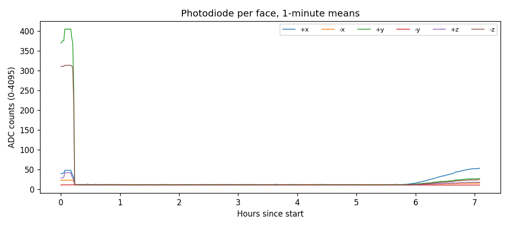
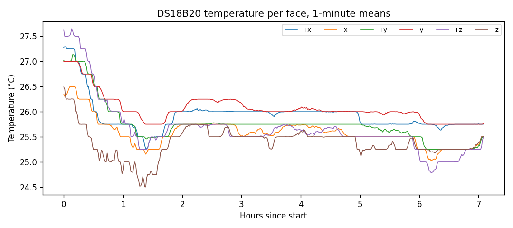
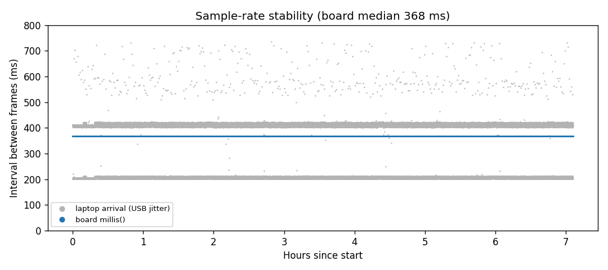

# Overnight endurance test (20 Nov 2026)

A 7.1-hour unattended run to check that Tetralux-1 keeps producing valid telemetry,
without drops, restarts or overheating, for far longer than the ≥ 2 h success criterion.

## Setup

- **Board:** Arduino Nano 33 IoT running the USB-only firmware (`WIFI_ENABLED 0`) from [`firmware/`](../../firmware/)
- **Sensors:** 6 × S1223 photodiodes, 6 × BH1750, QMC5883L magnetometer, 4 × OPT4048 (behind a TCA9548A I²C mux), 6 × DS18B20
- **Power:** 18650 Li-ion cell on a battery shield (EPS); data over USB serial at 115200 baud
- **Logger:** [`overnight_test/endurance_log.py`](../../overnight_test/endurance_log.py) on a laptop, cube stationary indoors (light level drops after ~15 min and rises again from ~6 h at dawn)
- **Run:** 2026-11-20 01:00:01 → 08:06:01 IST (7.10 h)

## Files

| File | What |
|---|---|
| `endurance_20261120_010001.csv` | Raw log, one row per line received from the board (138,751 rows) |
| `endurance_20261120_010001_events.csv` | Logger events: start, port open, stop. The local calibration file path is shortened to `calibration.json`; nothing else changed |
| `endurance_20261120_010001_markers.csv` | Pose markers (empty: no accuracy poses in this run) |
| `summary.txt` | Output of `scripts/summarize_endurance.py` |
| `plots/` | Photodiodes, temperatures and sample interval over time |

Regenerate the summary and plots:

```bash
python scripts/summarize_endurance.py data/endurance-test/endurance_20261120_010001.csv
```

### Columns (raw log)

Keep rows with `parse_ok == 1`; the other rows are status text from the board (`raw` column).

| Column | Unit | Meaning |
|---|---|---|
| `host_iso`, `host_mono` | ISO 8601 / s | Laptop arrival time; monotonic clock for intervals |
| `parse_ok`, `reject_reason` | 0/1, text | Valid JSON frame with correct checksum; why not |
| `seq`, `ts_ms` | int, ms | Board sequence number (gaps = lost frames); Arduino `millis()` |
| `pd_px … pd_nz` | ADC counts 0–4095 | Photodiode per face (+x, −x, +y, −y, +z, −z) |
| `lux_px … lux_nz` | lux | BH1750 per face |
| `mag_x, mag_y, mag_z` | raw counts | Magnetometer |
| `opt0_X … opt3_lux` | CIE XYZ, lux | OPT4048 sensors 0–3 |
| `temp_px … temp_nz` | °C | DS18B20 per face |
| `flags`, `chk` | bitfield, int | Firmware flags (bit 0 = Wi-Fi); XOR checksum |
| `est_x … est_el_deg` | unit vector, ° | Estimated sun direction, azimuth, elevation |
| `saturated_faces`, `raw` | list, text | Saturated faces; original line if not a frame |

## Results

| Measure | Result |
|---|---|
| Valid frames | **69,376 / 69,376 (100.000 %)** |
| Missing frames / duplicates / board restarts | 0 / 0 / 0 |
| Silent periods > 2 s | 0 |
| Interval (board clock) | 368 ms median, 368–369 ms (laptop arrival 200–735 ms from USB buffering) |
| Temperatures | 24.50–27.75 °C across all faces |





### Anomalies

- **All I²C sensors read 0 for the whole run**: every BH1750, the magnetometer and every OPT4048.
  They worked in a session the evening before, so the likely cause is the I²C bus or the mux.
  Only the photodiodes and DS18B20s produced data.
- The board printed `[BH1750] Device is not configured!` once per frame (69,375 lines). These
  are counted separately and are not frame losses.
- The 368 ms interval misses the original 10 ms spec. The firmware has since been changed to
  sample on a fixed 200 ms clock (not used in this run).
- No pose markers, so sun-direction accuracy was not measured here.
