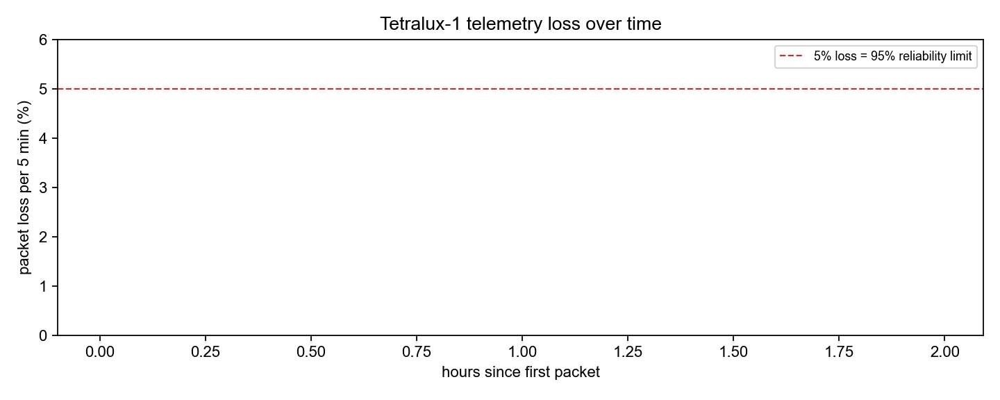
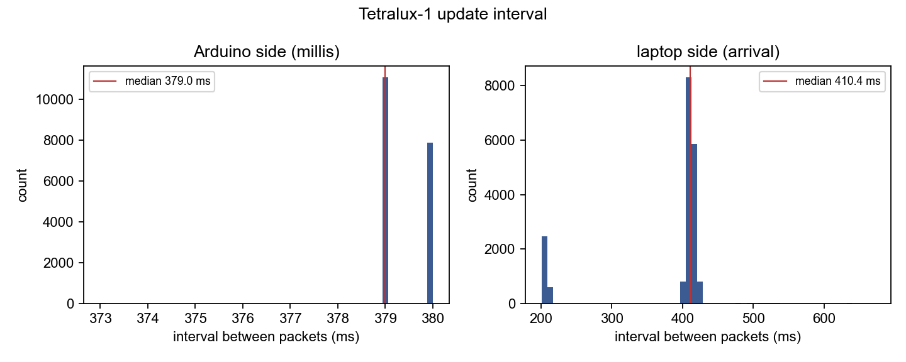
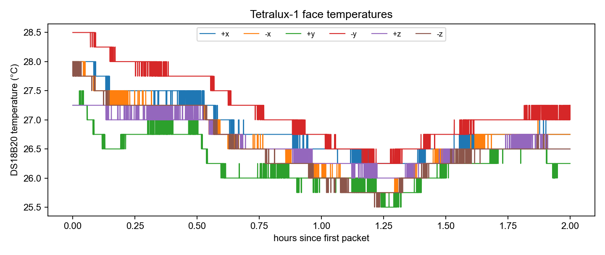

# Tetralux-1 overnight endurance test - results

Log: `endurance_20261118_005845.csv`  
First packet 2026-11-18T00:58:46.025+05:30, last packet 2026-11-18T02:58:45.678+05:30 (2.00 h, 120.0 min).  
All figures are computed from logged rows only; nothing is interpolated.

## Success criteria

| Criterion | Target | Measured | Result |
|---|---|---|---|
| Telemetry reliability, first 30 min | >= 95 % | 100.000 % (4744/4744) | PASS |
| Structural integrity: continuous operation | >= 2 h | 2.00 h logged, 0 disconnect(s), 0 board restart(s) | not measured (run < 2 h) |
| Telemetry reliability, first 2 h | (structural spec) | 100.000 % (18977/18977) | not measured |
| Telemetry reliability, full run | (for reference) | 100.000 % (18977/18977) | PASS |
| Sun-direction accuracy | <= 10 deg | no pose markers with estimates | not measured |
| Repeatability | <= 5 deg | no pose markers with estimates | not measured |

## Packets

- Lines received: 75908, of which 18977 were telemetry frames; parsed and checksum-valid: 18977 (**parse success 100.000 %** of frames).
- Non-frame status text from the board (logged, not counted as frames): `[BH1750] Device is not configured!` x56931
- Unique valid frames: 18977; duplicates ignored: 0.
- Board restarts (seq went backwards): 0. Frames lost exactly at a restart cannot be counted from seq numbers.

## Gaps in the sequence numbers

No gaps: every sequence number between the first and last frame arrived.

**Loss per 5-minute bucket** (24 buckets, `endurance_20261118_005845_buckets.csv`): 0 bucket(s) had any loss.
 Worst 30-minute stretch: 100.000 % (starting 0 min).

## Update interval

Only consecutive frames (no loss, no restart between them) are used.

| Side | n | mean | median | min | max | 95th pct |
|---|---|---|---|---|---|---|
| Arduino millis() | 18976 | 379.41 ms | 379.00 ms | 373.00 ms | 380.00 ms | 380.00 ms |
| Laptop arrival | 18976 | 379.41 ms | 410.42 ms | 200.88 ms | 671.08 ms | 420.21 ms |

Spec: 10 ms. Measured median: **379.0 ms** (~2.64 packets/s) - does **not** meet the 10 ms spec; the real interval is 38x longer.

Arduino clock vs laptop clock: +9 ppm (+0.03 s per hour).

## DS18B20 temperatures

| Face | readings | missing | first | last | min | max | mean |
|---|---|---|---|---|---|---|---|
| +x | 18977 | 0 | 28.00 | 26.75 | 26.25 | 28.00 | 26.87 |
| -x | 18977 | 0 | 28.00 | 26.75 | 25.75 | 28.00 | 26.67 |
| +y | 18977 | 0 | 27.25 | 26.25 | 25.50 | 27.50 | 26.28 |
| -y | 18977 | 0 | 28.50 | 27.25 | 26.25 | 28.50 | 27.18 |
| +z | 18977 | 0 | 27.25 | 26.50 | 26.00 | 27.25 | 26.60 |
| -z | 18977 | 0 | 28.00 | 26.50 | 25.50 | 28.00 | 26.56 |

Correlation across 5-minute buckets (Pearson r; |r| < 0.3 is weak):
- mean temperature vs packet loss: not measured
- mean temperature vs update interval: 0.31
- mean temperature vs summed photodiode counts: 0.88
(Correlation is not cause - room temperature and light also change overnight.)

## Disconnects and downtime

- USB disconnects with reconnect: 0
- Total port downtime: 0.0 s.
- Silent periods (port open, no data for >= 5 s): 0, total 0.0 s.

## Pose markers

No pose markers in this log.

## Charts

